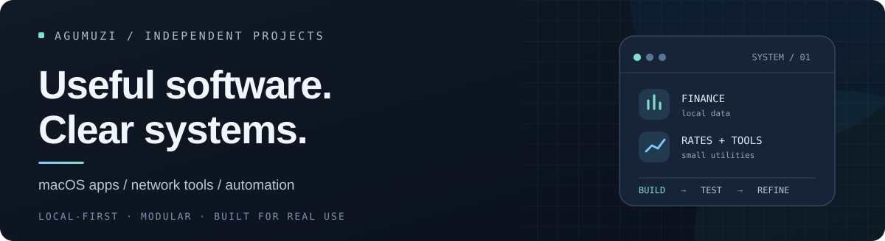

  

  <a href="https://github.com/Agumuzi/FinTrack">FinTrack</a> &nbsp;·&nbsp;
  <a href="https://github.com/Agumuzi/Currency-Tracker">Currency Tracker</a> &nbsp;·&nbsp;
  <a href="https://github.com/Agumuzi/crhopper">CR-Hopper</a>

I build independent software for everyday workflows — mostly native Mac apps, networking utilities, and small automation systems. I care about tools that are understandable, maintainable, and useful beyond the demo.

## Selected work

### 01 / [FinTrack](https://github.com/Agumuzi/FinTrack)

**Personal finance, made for Mac.**

A native macOS workspace for transactions, accounts, deposits, budgets, financial goals, and multiple currencies. Your financial records stay on your Mac.

[**Explore the project →**](https://github.com/Agumuzi/FinTrack) &nbsp; · &nbsp; [Product website](https://agumuzi.github.io/FinTrack/) &nbsp; · &nbsp; [Download](https://github.com/Agumuzi/FinTrack/releases/latest)

---

### 02 / [Currency Tracker](https://github.com/Agumuzi/Currency-Tracker)

**Exchange rates, without leaving the menu bar.**

Live exchange-rate cards, history charts, alerts, and quick conversion in a compact macOS app. Supports 11 interface languages.

[**Explore the project →**](https://github.com/Agumuzi/Currency-Tracker) &nbsp; · &nbsp; [Product website](https://agumuzi.github.io/Currency-Tracker/) &nbsp; · &nbsp; [Download](https://github.com/Agumuzi/Currency-Tracker/releases/latest)

---

### 03 / [CR-Hopper](https://github.com/Agumuzi/crhopper)

**Public proxy subscriptions, prepared for your client.**

A project that filters and republishes third-party public proxy sources in subscription formats for Hiddify, Mihomo, and Clash-compatible clients.

[**Explore the project →**](https://github.com/Agumuzi/crhopper) &nbsp; · &nbsp; [Website & quick start](https://agumuzi.github.io/crhopper/) &nbsp; · &nbsp; [Subscription formats](https://github.com/Agumuzi/crhopper#quick-start)

---

## How I approach software

**Local-first.** Keep data and essential workflows under the user's control whenever practical.

**Modular.** Design components to be replaceable, testable, and easier to troubleshoot.

**Useful over flashy.** Work from real usage, document limitations, and keep iterating.

<strong>简体中文 / 关于我和项目</strong>

我主要开发面向真实使用场景的 **macOS 应用、网络工具和自动化系统**。重视本地优先、模块化、易维护，以及清晰的项目边界。

- **[FinTrack](https://github.com/Agumuzi/FinTrack)：** 原生 Mac 个人财务应用，管理账目、资产、预算、目标和多币种数据。
- **[Currency Tracker](https://github.com/Agumuzi/Currency-Tracker)：** 菜单栏汇率工具，支持趋势图、汇率提醒、快捷换算和多语言。
- **[CR-Hopper](https://github.com/Agumuzi/crhopper)：** 将公开第三方代理节点整理为兼容 Hiddify、Mihomo 等客户端的订阅格式。

Each project has its own release cycle and limitations. CR-Hopper uses untrusted third-party public nodes; their availability and security are not guaranteed.
